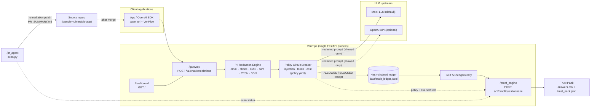

# VeriPipe

**Runtime-to-Revenue AI Security & Compliance Infrastructure.**
One gateway that (1) sanitises and polices every LLM call at runtime, (2) proves it with a tamper-evident ledger, (3) fixes code that bypasses it, and (4) turns that proof into completed enterprise security questionnaires.

Runs fully locally: no API keys, no Node build, no CDN. A built-in Mock LLM is the default upstream; real OpenAI pass-through is one env var away.

## Quick start

```bash
pip install -r requirements.txt
```

```bash
uvicorn gateway.main:app --reload
```

Open <http://localhost:8000>. (Python 3.10+. Run both commands from the repo root.)

### 3-minute demo script

| Step | Dashboard tab | Click | What you see |
|---|---|---|---|
| 1 | Live Simulator | **Simulate Dirty Prompt with IBAN + Email** | Email, phone and IBAN replaced by `[REDACTED_*]` before the model sees them; receipt with `chain_hash` |
| 2 | Live Simulator | **Simulate Prompt Injection Attack** | HTTP 403 `BLOCKED`, never forwarded, still receipted |
| 3 | Tamper-Evident Ledger | **Verify Cryptographic Chain** | `valid: true`, head hash + Merkle root |
| 4 | Tamper-Evident Ledger | **Simulate Log Tampering** → **Verify** | The blocked attack was rewritten to `ALLOWED` on disk; verification pinpoints the exact record |
| 5 | Auto-Remediation PR | **Run scan** | 4 ungoverned OpenAI calls in `sample-vulnerable-app/` and the git diff that fixes them |
| 6 | Questionnaire Resolver | **Resolve sample questionnaire** → **Download verified answers CSV** | 12/12 `YES - VERIFIED`, each with evidence and a verification hash. Repeat while the ledger is tampered and the ledger-backed answers flip to `NO - VERIFICATION FAILED` |

## Architecture



### Request lifecycle

1. **Redact**: every text field of `messages` is scanned. IBANs are validated with mod-97 and cards with Luhn to keep false positives down.
2. **Police**: the circuit breaker checks injection phrases (on the original text, punctuation- and case-insensitive), estimated prompt tokens, requested completion tokens and estimated cost against `policy.yaml`.
3. **Forward** the *redacted* payload to the upstream, only if allowed.
4. **Receipt**: exactly one record is appended per request, allowed or blocked:

```text
payload_hash = sha256(canonical_json(every receipt field except the 3 hash fields))
chain_hash   = sha256(prev_hash + payload_hash + timestamp)      # prev_hash of record 0 = 64 zeros
```

Because `payload_hash` covers `action`, `pii_redacted_count`, `policy_version`, `seq` and all other fields, editing, deleting, inserting or reordering any record breaks `GET /v1/ledger/verify`. The ledger stores hashes of prompts and responses, never their text.

## Repository layout

| Path | What it is |
|---|---|
| `gateway/` | FastAPI app: proxy, redaction, circuit breaker, ledger, self-test |
| `pr_agent/scan.py` | Stdlib-only CLI scanner + patch generator |
| `sample-vulnerable-app/` | Two intentionally unguarded files (`support_bot.py`, `summarize.js`) |
| `proof_engine/` | Questionnaire resolver, 12-question sample CSV, CLI |
| `dashboard/index.html` | Single-file UI served at `/` (Tailwind's browser build is vendored in `dashboard/vendor/`, so no CDN) |
| `policy.yaml` | All rules; hot-reloaded, versioned and hashed into every receipt |
| `data/` | Runtime output: ledger, generated patch, trust packs (git-ignored) |
| `tests/` | `pytest -q` (40 end-to-end tests) |

> The Python packages use underscores (`pr_agent`, `proof_engine`) because hyphenated directories are not importable.

## API

| Method & path | Purpose |
|---|---|
| `POST /v1/chat/completions` | OpenAI-compatible proxy. Response adds a `veripipe` object (receipt, redacted messages) and `X-VeriPipe-*` headers. Blocked requests return 403 |
| `GET /v1/ledger/verify` | `{ "valid": true, "total_records": N, "broken_at_index": null, ... }` |
| `GET /v1/ledger`, `GET /v1/ledger/stats` | Receipts and aggregate telemetry |
| `GET /v1/policy` | Active policy, version and SHA-256 |
| `POST /v1/selftest` | Pushes synthetic PII / injection / oversize probes through the real pipeline |
| `POST /v1/pr-agent/scan` | Runs the scanner, returns findings + patch + PR summary |
| `POST /v1/proof/questionnaire` | Body = raw CSV (empty body = bundled sample). `?format=csv` returns only the completed CSV |
| `POST /v1/ledger/tamper`, `/restore`, `/reset` | Demo only; disabled when `demo_mode: false` |

```bash
curl -s localhost:8000/v1/chat/completions -H 'Content-Type: application/json' \
  -d '{"model":"gpt-4o-mini","messages":[{"role":"user","content":"Refund aoife@example.ie to IE29 AIBK 9311 5212 3456 78"}]}'
```

```bash
curl -s localhost:8000/v1/ledger/verify
```

```bash
curl -s -X POST 'localhost:8000/v1/proof/questionnaire?format=csv' -H 'Content-Type: text/csv' \
  --data-binary @proof_engine/sample_questionnaire.csv -o answers.csv
```

Existing OpenAI SDK code only needs a new base URL:

```python
client = OpenAI(base_url="http://localhost:8000/v1", api_key="unused-in-mock-mode")
```

## PR agent

```bash
python pr_agent/scan.py sample-vulnerable-app
```

Writes `remediation.patch`, `PR_SUMMARY.md` and `scan_status.json` to the current directory (`--out-dir` to change, `--gateway-url` / `--app-id` to customise, `--fail-on-findings` for CI). Apply with:

```bash
git apply remediation.patch
```

Detected: `OpenAI(...)` / `openai.OpenAI(...)` / `AsyncOpenAI(...)` / `new OpenAI(...)` without a base URL, and literal `api.openai.com` URLs, in `.py .js .mjs .cjs .jsx .ts .tsx`. The rewrite adds the gateway base URL plus `X-VeriPipe-App-Id`, `X-VeriPipe-Data-Classification` and `X-VeriPipe-Regulatory-Scope` headers.

## Proof engine

There is no LLM in the proof engine. Each question is matched to one of 12 controls by keyword rules; each control is a pure function over telemetry collected at request time:

| Evidence source | Used for |
|---|---|
| Live self-test (`/v1/selftest`) | Proves redaction, injection blocking and token limits work *right now* |
| `GET /v1/ledger/verify` | Chain validity, head hash, Merkle root |
| Ledger stats | Counts, block reasons, policy versions, PII sweep of the ledger file |
| `policy.yaml` | Configured limits, version, file hash |
| PR-agent scan | Ungoverned call sites found / covered by the patch |

Outcomes: `YES - VERIFIED`, `NO - VERIFICATION FAILED` (the control could not be proven, for example after tampering), or `NEEDS HUMAN REVIEW - NO TELEMETRY MAPPING` (no control matches; the engine will not invent an answer). Every answer carries a `verification_hash` binding the question, answer and metrics to the ledger head, Merkle root and policy hash at that moment.

```bash
python -m proof_engine.cli --gateway http://localhost:8000
```

## Regulatory mapping

VeriPipe produces technical evidence that supports these obligations. It is not legal advice and does not by itself make a system compliant.

### EU AI Act (Regulation (EU) 2024/1689)

| Provision | Requirement (short) | VeriPipe control | Evidence |
|---|---|---|---|
| Art. 12(1) | Automatic recording of events over the system's lifetime | One receipt per request, allowed or blocked | `data/audit_ledger.jsonl`, `/v1/ledger` |
| Art. 12(2) | Logs enable traceability and monitoring | `policy_version` + `policy_hash`, model, upstream, app id in every receipt | `/v1/ledger/stats` |
| Art. 19 / Art. 26(6) | Providers and deployers keep automatically generated logs | Append-only JSONL with integrity proof, exportable | `/v1/ledger/verify` |
| Art. 15(4)-(5) | Robustness and cybersecurity, incl. resilience to manipulation of inputs | Prompt-injection circuit breaker, token/cost limits | `/v1/selftest`, BLOCKED receipts |
| Art. 10 (data governance, where applicable) | Appropriate handling of personal data | Inline PII redaction before any third-party transfer | `pii_redacted_count`, `pii_types` |

### DORA (Regulation (EU) 2022/2554)

| Provision | Requirement (short) | VeriPipe control | Evidence |
|---|---|---|---|
| Art. 9 | Protection and prevention; safeguards against misuse of ICT systems | Policy circuit breaker, usage ceilings | `policy.yaml`, `/v1/selftest` |
| Art. 10 | Detection of anomalous activities | Blocked-request receipts with machine-readable reason | `/v1/ledger/stats` → `block_reasons` |
| Art. 17 | ICT-related incident management: record, classify | Timestamped, reasoned, tamper-evident block records | `/v1/ledger` |
| Art. 28(3) | Register of information on ICT third-party arrangements | Every outbound call records provider and model | `/v1/ledger/stats` → `upstreams`, `models` |
| Art. 28 / Art. 30(3)(e) | Audit and access rights over ICT third-party providers | Anyone can recompute the chain from the plain-text ledger | `/v1/ledger/verify`, Trust Pack |

### GDPR

| Provision | VeriPipe control |
|---|---|
| Art. 5(1)(c) data minimisation | Redaction before transfer; ledger keeps hashes, not content |
| Art. 25 data protection by design | Redaction is in-path and on by default |
| Art. 32 security of processing | Detector coverage self-tested on every questionnaire run |

## Configuration

| Setting | Where | Default |
|---|---|---|
| Rules, limits, pricing, detectors | `policy.yaml` | see file |
| `VERIPIPE_UPSTREAM_MODE` | env (`mock` / `openai`) | `mock` |
| `OPENAI_API_KEY` | env; used in `openai` mode (falls back to the client's `Authorization` header) | unset |
| `VERIPIPE_DATA_DIR`, `VERIPIPE_POLICY_PATH` | env | `./data`, `./policy.yaml` |

Real OpenAI pass-through:

```bash
VERIPIPE_UPSTREAM_MODE=openai OPENAI_API_KEY=sk-... uvicorn gateway.main:app
```

## Known limits of this MVP

- **Streaming** (`stream: true`) is rejected with 400; only `/v1/chat/completions` is proxied.
- **Truncation**: a hash chain proves the records that exist are unmodified and in order. Deleting records from the *tail* is only detectable if the head hash was anchored elsewhere. Each Trust Pack records the head hash and Merkle root; production use should also publish them to an external store or timestamping service.
- **PII detection is pattern-based**. It does not catch names, addresses or free-text identifiers, and model *responses* are not scanned.
- **Injection defence is a phrase list**, effective against known strings, not a classifier.
- **Token and cost figures are estimates** (about 4 characters per token; prices from `policy.yaml`).
- **No authentication** on any endpoint, and the ledger is a single local file guarded by an in-process lock: run one worker, and set `demo_mode: false` outside demos.
- **PR-agent header injection** for raw HTTP calls needs an `Authorization:` line on its own row within 12 lines of the URL; otherwise the URL is re-routed and the PR summary flags the headers for manual follow-up.
